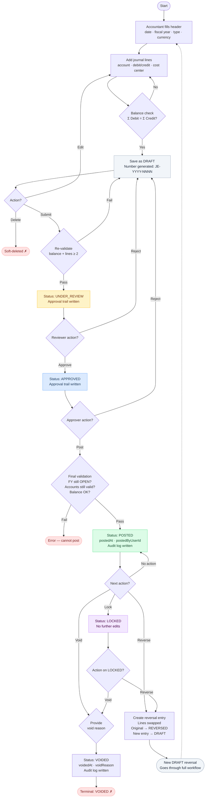

# Technical Design Document — Journal Entries Module

**Project:** Mans ERP
**Module:** Journal Entries (General Ledger)
**Version:** 1.0
**Date:** 2026-06-30
**Status:** As-Built (Phase 3 — Complete)
**Author:** Technical Architect

> This document is the authoritative technical reference for the Journal Entries module.
> No code change to this module may proceed without updating this document first.
> Approval is required before implementing any enhancement beyond this baseline.

---

## 1. Database Tables

### 1.1 `journal_entries` (Primary Table)

| Column | Type | Nullable | Description |
|---|---|---|---|
| `id` | UUID PK | No | Auto-generated UUID |
| `organization_id` | UUID FK | No | Owning organization |
| `branch_id` | UUID FK | Yes | Optional branch scoping |
| `fiscal_year_id` | UUID FK | No | Must reference an OPEN fiscal year |
| `number` | String | No | Unique per org — `JE-{YEAR}-{SEQ}` |
| `entry_date` | Date | No | Date of the accounting event |
| `type` | Enum | No | MANUAL / AUTOMATIC / OPENING / CLOSING / ADJUSTMENT |
| `status` | Enum | No | See §6 — State Transitions |
| `currency_code` | String | No | Default: SAR |
| `exchange_rate` | Decimal(18,8) | No | Default: 1.0 |
| `total_debit` | Decimal(18,4) | No | Sum of all line debits |
| `total_credit` | Decimal(18,4) | No | Sum of all line credits (must equal total_debit) |
| `description_en` | String | Yes | English description |
| `description_ar` | String | Yes | Arabic description |
| `reference` | String | Yes | External reference number |
| `source_type` | String | Yes | Module source (e.g. `bank_transaction`) |
| `source_id` | UUID | Yes | Source record ID |
| `posted_at` | DateTime | Yes | Timestamp of posting |
| `posted_by_user_id` | UUID FK | Yes | User who posted |
| `voided_at` | DateTime | Yes | Timestamp of void |
| `voided_by_user_id` | UUID FK | Yes | User who voided |
| `void_reason` | String | Yes | Mandatory reason for void |
| `submitted_at` | DateTime | Yes | Timestamp of submission |
| `submitted_by_user_id` | UUID FK | Yes | User who submitted |
| `approved_at` | DateTime | Yes | Timestamp of approval |
| `approved_by_user_id` | UUID FK | Yes | User who approved |
| `is_reversal` | Boolean | No | True if this entry is a reversal |
| `reversal_of_entry_id` | UUID FK | Yes | The original entry this reverses |
| `reversed_by_entry_id` | UUID FK | Yes | The reversal entry (on the original) |
| `created_by_user_id` | UUID FK | Yes | User who created |
| `deleted_at` | DateTime | Yes | Soft-delete timestamp |
| `created_at` | DateTime | No | Record creation timestamp |
| `updated_at` | DateTime | No | Last update timestamp |

**Unique constraint:** `(organization_id, number)`

**Indexes:** `organization_id`, `fiscal_year_id`, `status`, `type`, `entry_date`, `source_type + source_id`, `deleted_at`

---

### 1.2 `journal_entry_lines` (Line Items)

| Column | Type | Nullable | Description |
|---|---|---|---|
| `id` | UUID PK | No | Auto-generated UUID |
| `journal_entry_id` | UUID FK | No | Parent journal entry |
| `account_id` | UUID FK | No | COA leaf account |
| `cost_center_id` | UUID FK | Yes | Optional cost center |
| `line_number` | Int | No | 1-based ordering |
| `description_en` | String | Yes | Line description (English) |
| `description_ar` | String | Yes | Line description (Arabic) |
| `debit` | Decimal(18,4) | No | Amount in transaction currency |
| `credit` | Decimal(18,4) | No | Amount in transaction currency |
| `debit_base` | Decimal(18,4) | No | `debit × exchange_rate` (SAR) |
| `credit_base` | Decimal(18,4) | No | `credit × exchange_rate` (SAR) |
| `reference` | String | Yes | Line-level reference |
| `created_at` | DateTime | No | — |
| `updated_at` | DateTime | No | — |

**Constraint:** On each line, exactly one of `debit` or `credit` must be > 0 (enforced at service layer).

**Indexes:** `journal_entry_id`, `account_id`, `cost_center_id`

---

### 1.3 `journal_entry_approvals` (Workflow Trail)

| Column | Type | Nullable | Description |
|---|---|---|---|
| `id` | UUID PK | No | — |
| `journal_entry_id` | UUID FK | No | Parent journal entry |
| `user_id` | UUID FK | No | Actor |
| `action` | String | No | SUBMIT / APPROVE / REJECT / POST / LOCK / VOID / REVERSE |
| `comment` | String | Yes | Optional note from the actor |
| `from_status` | String | Yes | Status before the action |
| `to_status` | String | Yes | Status after the action |
| `created_at` | DateTime | No | Action timestamp |

**Purpose:** Full, immutable workflow audit trail per entry. Never deleted.

---

### 1.4 `journal_entry_templates`

Reusable header + line skeletons. Stores `nameEn`, `nameAr`, `type`, `currencyCode`, and an array of `JournalEntryTemplateLine` rows. Used to pre-populate the create form.

---

### 1.5 Supporting Tables (referenced)

| Table | Role |
|---|---|
| `fiscal_years` | Determines valid posting period; must be OPEN |
| `chart_of_accounts` | Validates account eligibility at every write |
| `cost_centers` | Optional dimension on every line |
| `audit_logs` | Platform-wide immutable event log |

---

## 2. API Endpoints

All endpoints are authenticated via Clerk (`requireAuth()`). All request bodies are validated with Zod before any database operation.

| Method | Path | Description | Auth |
|---|---|---|---|
| `GET` | `/api/journal-entries` | Paginated list with filters | Required |
| `GET` | `/api/journal-entries/:id` | Full detail with lines, approvals, and relations | Required |
| `POST` | `/api/journal-entries` | Create new draft | Required |
| `PATCH` | `/api/journal-entries/:id` | Update DRAFT or UNDER_REVIEW entry | Required |
| `DELETE` | `/api/journal-entries/:id` | Soft-delete DRAFT entry | Required |
| `POST` | `/api/journal-entries/:id/submit` | DRAFT → UNDER_REVIEW | Required |
| `POST` | `/api/journal-entries/:id/approve` | UNDER_REVIEW → APPROVED | Required |
| `POST` | `/api/journal-entries/:id/reject` | UNDER_REVIEW or APPROVED → DRAFT | Required |
| `POST` | `/api/journal-entries/:id/post` | APPROVED → POSTED | Required |
| `POST` | `/api/journal-entries/:id/lock` | POSTED → LOCKED | Required |
| `POST` | `/api/journal-entries/:id/void` | POSTED or LOCKED → VOIDED | Required |
| `POST` | `/api/journal-entries/:id/reverse` | POSTED or LOCKED → creates reversal entry | Required |
| `POST` | `/api/journal-entries/:id/copy` | Any status → creates new DRAFT copy | Required |

### 2.1 Query Parameters — GET /api/journal-entries

| Parameter | Type | Description |
|---|---|---|
| `search` | String | Matches number, descriptionEn, descriptionAr, reference |
| `status` | Enum | Filter by status |
| `type` | Enum | Filter by type |
| `organizationId` | UUID | Scoping (defaults to user's org) |
| `fiscalYearId` | UUID | Filter by fiscal year |
| `startDate` | Date | `entryDate ≥ startDate` |
| `endDate` | Date | `entryDate ≤ endDate` |
| `page` | Int | Default: 1 |
| `pageSize` | Int | Default: 20, max: 100 |

### 2.2 Response Shape — List

```json
{
  "data": [ { ...JournalEntry, createdBy, fiscalYear, _count: { lines } } ],
  "meta": { "page": 1, "pageSize": 20, "total": 145, "totalPages": 8 }
}
```

---

## 3. UI Pages

### 3.1 `/journal-entries` — List Page (`JournalEntries.tsx`)

| State | Implementation |
|---|---|
| **Loading** | Full-table skeleton rows (8 rows × 10 columns) |
| **Empty** | Icon + message + "New Entry" CTA button |
| **Error** | Toast notification with error message |
| **Success** | Paginated table with status tabs |
| **Responsive** | Horizontal scroll on narrow viewports |

**Features:**
- Status tab bar: ALL / DRAFT / UNDER_REVIEW / APPROVED / POSTED / LOCKED / REVERSED
- Type filter dropdown
- Debounced search (400ms) on number, description, reference
- Row click → navigate to detail
- Hover-revealed action menu: View, Edit (DRAFT/UNDER_REVIEW only), Submit (DRAFT only), Copy, Delete (DRAFT only)
- Pagination controls with page counter
- REV badge on reversal entries

---

### 3.2 `/journal-entries/new` and `/journal-entries/:id/edit` — Form Page (`JournalEntryForm.tsx`)

| State | Implementation |
|---|---|
| **Loading (edit)** | Skeleton while loading existing entry |
| **Empty lines** | Minimum 2 lines enforced |
| **Balance indicator** | Live green (balanced) / red (unbalanced) / grey (empty) bar |
| **Error** | Toast + disabled submit while unbalanced |
| **Success** | Toast + redirect to detail |

**Features:**
- Header fields: date, fiscal year (OPEN only), type, currency, exchange rate, descriptions (EN + AR), reference
- Line table: account combobox (searchable, leaf accounts only), description, cost center, debit, credit
- Account combobox: filtered to `isActive=true`, `isGroup=false`, `allowDirectEntry=true`
- Debit/credit mutual exclusivity (entering debit clears credit and vice versa)
- Live running totals in tfoot
- Minimum 2 lines; delete disabled when count = 2
- Edit mode: blocks navigation if entry is not DRAFT or UNDER_REVIEW

---

### 3.3 `/journal-entries/:id` — Detail Page (`JournalEntryDetail.tsx`)

| State | Implementation |
|---|---|
| **Loading** | Skeleton layout |
| **Not found** | Error message with back button |
| **Error** | Error message |
| **Success** | Full detail with all workflow actions |

**Features:**
- Header card: all metadata, timestamps, actors
- Lines table: account code + name, cost center, debit, credit (base amounts if foreign currency)
- Reversal badge + link to/from related entry
- Approval history timeline
- Contextual action buttons (status-driven visibility)
- Copy action available from any status

---

## 4. User Workflow

```
Accountant creates draft → optionally edits → submits for review
                                  ↓
Reviewer reviews → approves (or rejects back to draft)
                                  ↓
Accountant/Manager posts the approved entry
                                  ↓
Entry is now permanent in the ledger
                                  ↓
  [Optional] Supervisor locks the entry
  [Optional] Authorized user voids or reverses
```

---

## 5. Journal Entry Lifecycle

```
Create  →  DRAFT  →  Submit  →  UNDER_REVIEW  →  Approve  →  APPROVED  →  Post  →  POSTED
                  ↑                          ↓                         ↓              ↓    ↓
                  └──────── Reject ──────────┘                         │           Lock  Void/Reverse
                                                                        └── Reject →
                                                                            DRAFT
```

**Terminal states:** VOIDED, LOCKED (cannot transition further except LOCKED → VOIDED or LOCKED → REVERSED)

---

## 6. State Transitions

| From | Action | To | Guard |
|---|---|---|---|
| *(none)* | Create | DRAFT | Fiscal year OPEN; balanced; valid accounts |
| DRAFT | Edit | DRAFT | Status is DRAFT or UNDER_REVIEW |
| DRAFT | Delete | *(soft-deleted)* | Status must be DRAFT |
| DRAFT | Submit | UNDER_REVIEW | ≥ 2 lines; balanced |
| UNDER_REVIEW | Approve | APPROVED | Status must be UNDER_REVIEW |
| UNDER_REVIEW | Reject | DRAFT | Clears submittedAt, approvedAt |
| APPROVED | Reject | DRAFT | Clears approvedAt |
| APPROVED | Post | POSTED | Fiscal year still OPEN; re-validates accounts; re-validates balance |
| POSTED | Lock | LOCKED | Status must be POSTED |
| POSTED | Void | VOIDED | Requires void reason |
| POSTED | Reverse | POSTED (new entry) | Creates a new reversal entry in DRAFT |
| LOCKED | Void | VOIDED | Requires void reason |
| LOCKED | Reverse | POSTED (new entry) | Creates a new reversal entry in DRAFT |

**Immutability rule:** POSTED, LOCKED, VOIDED, and REVERSED entries cannot be edited or deleted.

---

## 7. Validation Rules

### 7.1 Header Validation (Zod schema — enforced on create and update)

| Field | Rule |
|---|---|
| `fiscalYearId` | Required; must exist; must belong to same org; must be `status = OPEN` |
| `entryDate` | Required; format `YYYY-MM-DD` |
| `type` | One of: MANUAL, AUTOMATIC, OPENING, CLOSING, ADJUSTMENT |
| `currencyCode` | String (SAR default) |
| `exchangeRate` | Positive number, default 1.0 |
| `lines` | Minimum 2 items |

### 7.2 Line Validation (per line)

| Field | Rule |
|---|---|
| `accountId` | Required; valid UUID; account exists in org; `isActive=true`; `isGroup=false`; `allowDirectEntry=true` |
| `lineNumber` | Positive integer |
| `debit` | ≥ 0, Decimal |
| `credit` | ≥ 0, Decimal |
| `costCenterId` | Optional UUID; if provided, must exist |

### 7.3 Double-Entry Balance Rule

```
abs(Σ debit − Σ credit) < 0.01
```

Checked on: Create, Update (if lines provided), Submit, Post.

### 7.4 Account Eligibility (enforced at service layer)

An account may only be used in a journal entry line if **all three** conditions are met:
1. `isActive = true`
2. `isGroup = false`
3. `allowDirectEntry = true`

### 7.5 Fiscal Year Gate

The fiscal year must be `status = OPEN` at the time of:
- Create
- Post (re-checked — fiscal year may have been closed after approval)

---

## 8. Posting Workflow

When `POST /api/journal-entries/:id/post` is called:

1. Resolve entry (must exist, not soft-deleted).
2. Assert `status = APPROVED` → 400 if not.
3. Assert `lines.length ≥ 2` → 400 if not.
4. Re-validate double-entry balance → 400 if unbalanced.
5. Re-fetch fiscal year → assert `status = OPEN` → 400 if closed.
6. For every line, re-assert account `isActive` and `!isGroup` → 400 if violated.
7. Update `status = POSTED`, `postedAt = now()`, `postedByUserId = user.id`.
8. Write `JournalEntryApproval` record: action=`POST`, from=`APPROVED`, to=`POSTED`.
9. Write `AuditLog`: action=`POST`.
10. Return updated entry.

**Idempotency:** Calling post on an already-POSTED entry returns 400, not 200.

---

## 9. Reversal Entry Workflow

When `POST /api/journal-entries/:id/reverse` is called:

1. Resolve original entry (must be POSTED or LOCKED).
2. Assert original is not already reversed (`reversedByEntryId` is null) → 409 if already reversed.
3. Generate a new journal number for the reversal.
4. Create a new `JournalEntry` in `DRAFT` status with:
   - `isReversal = true`
   - `reversalOfEntryId = original.id`
   - Same fiscal year, currency, exchange rate
   - `entryDate` = today (or caller-supplied date)
   - Lines: each original line with **debit and credit swapped**
   - `descriptionEn` = `"Reversal of {original.number}"`
   - `descriptionAr` = `"عكس القيد {original.number}"`
5. Update original entry: `reversedByEntryId = newEntry.id`, `status = REVERSED`.
6. Write `JournalEntryApproval` on original: action=`REVERSE`.
7. Write `AuditLog` on both entries.
8. Return the new reversal entry.

**Note:** The reversal entry itself must go through the full workflow (submit → approve → post) before it affects the ledger.

---

## 10. Approval Workflow

### Roles and Permitted Actions

| Action | Permitted Roles |
|---|---|
| Create / Edit | Accountant, Accounting Manager, Admin |
| Submit | Accountant, Accounting Manager, Admin |
| Approve | Accounting Manager, Finance Director, Admin |
| Reject | Accounting Manager, Finance Director, Admin |
| Post | Accounting Manager, Finance Director, Admin |
| Lock | Finance Director, Admin |
| Void | Finance Director, Admin |
| Reverse | Finance Director, Admin |
| View | All authenticated users |

> RBAC enforcement is pending full role implementation (Phase 1 enhancement). Currently all authenticated users may perform all actions.

### Approval Record

Every workflow transition writes a `JournalEntryApproval` row with the actor, action, comment, and status transition. This record is immutable and is the audit trail for governance and regulatory purposes.

---

## 11. Numbering Strategy

**Format:** `JE-{YYYY}-{NNNN}`

**Examples:** `JE-2025-0001`, `JE-2025-0142`, `JE-2026-0001`

**Algorithm:**
1. Determine `year` from `entryDate`.
2. Query all `JournalEntry` records for the same `organizationId` where `number LIKE 'JE-{year}-%'`.
3. Parse the numeric suffix from each match.
4. Take `max + 1`, left-pad to 4 digits.
5. Result is `JE-{year}-{padded}`.

**Scope:** Number sequence resets per calendar year. Unique per `(organizationId, number)`.

**Known limitation:** The current approach is not atomic under high concurrency. A database sequence or advisory lock should replace it in a future sprint (see §20).

---

## 12. Permission Matrix

| Action | Accountant | Acct. Manager | Finance Director | Auditor | Admin |
|---|---|---|---|---|---|
| View list | ✓ | ✓ | ✓ | ✓ | ✓ |
| View detail | ✓ | ✓ | ✓ | ✓ | ✓ |
| Create (draft) | ✓ | ✓ | ✓ | — | ✓ |
| Edit (draft) | ✓ | ✓ | ✓ | — | ✓ |
| Delete (draft) | ✓ | ✓ | ✓ | — | ✓ |
| Submit | ✓ | ✓ | ✓ | — | ✓ |
| Approve | — | ✓ | ✓ | — | ✓ |
| Reject | — | ✓ | ✓ | — | ✓ |
| Post | — | ✓ | ✓ | — | ✓ |
| Lock | — | — | ✓ | — | ✓ |
| Void | — | — | ✓ | — | ✓ |
| Reverse | — | — | ✓ | — | ✓ |
| Copy | ✓ | ✓ | ✓ | ✓ | ✓ |
| Export | ✓ | ✓ | ✓ | ✓ | ✓ |

---

## 13. Error Handling

### HTTP Status Codes

| Situation | Code | Message Pattern |
|---|---|---|
| Invalid request body | 400 | `"Validation failed"` + Zod flatten |
| Business rule violation | 400 | Specific message (e.g. `"Entry is not balanced"`) |
| User not found in DB | 401 | `"User not found"` |
| Record not found | 404 | `"Journal entry not found"` |
| Status conflict | 400 | `"Cannot {action} a {status} entry"` |
| Already reversed | 409 | `"Entry has already been reversed"` |
| Internal error | 500 | `"Failed to {action} journal entry"` |

### Frontend Error Handling

- Network / API errors → destructive toast with error message from `err.response.data.error`
- Validation errors → toast before API call (balance check, empty accounts)
- Status conflicts → toast + redirect (e.g. editing a non-editable entry redirects to detail)
- All mutations wrapped in `onError` handlers; no silent failures

---

## 14. Audit Events

Every operation on a journal entry writes to the `audit_logs` table.

| Operation | Audit Action | Entity Type | Description |
|---|---|---|---|
| Create | `CREATE` | `journal_entry` | `"Created journal entry {number}"` |
| Update | `UPDATE` | `journal_entry` | `"Updated journal entry {number}"` |
| Delete | `DELETE` | `journal_entry` | `"Deleted draft {number}"` |
| Submit | — | — | Written as `JournalEntryApproval` only |
| Approve | `APPROVE` | `journal_entry` | `"Approved {number}"` |
| Reject | `REJECT` | `journal_entry` | `"Rejected {number}: {comment}"` |
| Post | `POST` | `journal_entry` | `"Posted {number}"` |
| Lock | — | — | Written as `JournalEntryApproval` only |
| Void | `VOID` | `journal_entry` | `"Voided {number}: {reason}"` |
| Reverse | `CREATE` × 2 | `journal_entry` | On both original and reversal |
| Copy | `CREATE` | `journal_entry` | `"Copied from {source.number}"` |

All audit log entries include: `userId`, `userEmail`, `action`, `entityType`, `entityId`, `oldValues`, `newValues`, `description`.

---

## 15. Sequence Diagrams

### 15.1 Create → Post (Happy Path)

```
Accountant        API Server                   Database
    │                  │                           │
    │── POST /je ──────►│                           │
    │                  │── validateFiscalYear() ───►│
    │                  │◄── FY: OPEN ───────────────│
    │                  │── validateBalance() ───────│ (in-memory)
    │                  │── validateAccounts() ──────►│
    │                  │◄── accounts: valid ─────────│
    │                  │── generateNumber() ─────────►│
    │                  │◄── JE-2026-0001 ─────────────│
    │                  │── journalEntry.create() ─────►│
    │                  │── auditLog.create() ──────────►│
    │◄── 201 DRAFT ─────│                           │
    │                  │                           │
    │── POST /:id/submit►│                           │
    │                  │── validateBalance() ───────│
    │                  │── journalEntry.update() ────►│ status=UNDER_REVIEW
    │                  │── approval.create() ─────────►│ action=SUBMIT
    │◄── 200 UNDER_REVIEW│                           │
    │                  │                           │
Manager           API Server                   Database
    │── POST /:id/approve►│                           │
    │                  │── journalEntry.update() ────►│ status=APPROVED
    │                  │── approval.create() ─────────►│ action=APPROVE
    │                  │── auditLog.create() ──────────►│
    │◄── 200 APPROVED ──│                           │
    │                  │                           │
    │── POST /:id/post ─►│                           │
    │                  │── re-validate balance ─────│
    │                  │── re-validate FY.status ───►│
    │                  │── re-validate accounts ─────►│
    │                  │── journalEntry.update() ────►│ status=POSTED
    │                  │── approval.create() ─────────►│ action=POST
    │                  │── auditLog.create() ──────────►│
    │◄── 200 POSTED ────│                           │
```

---

### 15.2 Reversal Flow

```
Director          API Server                   Database
    │── POST /:id/reverse►│                           │
    │                  │── fetch original ───────────►│
    │                  │◄── POSTED, not reversed ──────│
    │                  │── generateNumber() ──────────►│ JE-2026-0098
    │                  │── journalEntry.create() ──────►│ isReversal=true, DRAFT
    │                  │── journalEntry.update(orig) ──►│ status=REVERSED
    │                  │── approval.create() ──────────►│ REVERSE
    │                  │── auditLog × 2 ───────────────►│
    │◄── 201 new DRAFT ─│                           │
    │                  │                           │
    │   [New reversal entry must go through full workflow before ledger effect]
```

---

## 16. Edge Cases

| Scenario | Handling |
|---|---|
| Fiscal year closed between approval and posting | Re-check at POST time → 400 if closed |
| Account deactivated between creation and posting | Re-check at POST time → 400 per inactive account |
| Duplicate submit (network retry) | 400 — entry is already UNDER_REVIEW |
| Reversal of a reversed entry | 409 — `reversedByEntryId` is already set |
| Posting with zero amounts | Balance check: `totalDebit > 0` required |
| 2-line minimum violation | Rejected at Zod schema level (min(2)) and re-checked at submit/post |
| Non-SAR currency with exchangeRate=1 | Allowed; debitBase = debit, creditBase = credit |
| Entry date in closed fiscal year period | Fiscal year validity is checked — if FY is OPEN, any date within the FY is valid |
| Copy of a VOIDED entry | Allowed — creates clean DRAFT (not marked as reversal) |
| Concurrent number generation | Race condition possible — must be resolved with DB sequence in future (§20) |
| Delete with lines | Soft-delete only; cascade is not triggered (`deletedAt` set on header only) |

---

## 17. Testing Strategy

### 17.1 Unit Tests (Service Layer)

| Test | Assertion |
|---|---|
| `validateBalance` — equal amounts | Returns `balanced = true` |
| `validateBalance` — unequal amounts | Returns `balanced = false` |
| `validateBalance` — within 0.01 tolerance | Returns `balanced = true` |
| `generateJournalNumber` — first entry | Returns `JE-2026-0001` |
| `generateJournalNumber` — 10th entry | Returns `JE-2026-0010` |
| `generateJournalNumber` — year rollover | Returns `JE-2027-0001` |
| `validateAccounts` — inactive account | Returns error message |
| `validateAccounts` — group account | Returns error message |
| `validateAccounts` — no direct entry | Returns error message |
| `validateAccounts` — valid account | Returns empty array |

### 17.2 Integration Tests (API Layer)

| Test | Scenario |
|---|---|
| POST `/journal-entries` | Valid payload → 201, correct number format |
| POST `/journal-entries` | Unbalanced → 400 |
| POST `/journal-entries` | Closed fiscal year → 400 |
| POST `/journal-entries` | Group account → 400 |
| PATCH `/:id` | Edit POSTED entry → 400 |
| POST `/:id/submit` | From DRAFT → 200, status=UNDER_REVIEW |
| POST `/:id/submit` | From POSTED → 400 |
| POST `/:id/approve` | From UNDER_REVIEW → 200, status=APPROVED |
| POST `/:id/post` | From APPROVED → 200, status=POSTED |
| POST `/:id/post` | Fiscal year closed after approval → 400 |
| POST `/:id/reverse` | POSTED entry → 201 reversal, original=REVERSED |
| POST `/:id/reverse` | Already reversed → 409 |
| DELETE `/:id` | DRAFT entry → 200, soft-deleted |
| DELETE `/:id` | POSTED entry → 400 |
| GET `/` | Pagination meta correct |
| GET `/:id` | Includes lines, approvals, actors |

### 17.3 Frontend Tests (E2E — Playwright)

| Test | Scenario |
|---|---|
| Navigate to `/journal-entries` | Page loads, status tabs visible |
| All 5 UI states | Loading, empty, error, success, responsive |
| Create form | Balance indicator turns green when balanced |
| Create form | Submit blocked when unbalanced |
| Create form | Account combobox filters leaf accounts only |
| List page | Row click navigates to detail |
| Detail page | Correct action buttons per status |
| Detail page | Reversal badge and link shown |

---

## 18. Performance Considerations

| Concern | Mitigation |
|---|---|
| List query on large orgs | Indexes on `organization_id`, `status`, `entry_date`; pagination enforced (max 100/page) |
| Account combobox (500 accounts) | Fetched once on mount; filtered client-side; Command component handles virtualization |
| Approval history | Eager-loaded in a single JOIN on `GET /:id` — no N+1 |
| Balance validation | In-memory arithmetic — no DB query |
| Account validation | One DB query per line (N queries) — acceptable for typical entries (2–20 lines); can be batched in future |
| Number generation | Full table scan on number prefix — acceptable at current scale; replace with DB sequence for >10k entries/org/year |
| Lines replace on update | Delete-all + create-all per update (not atomic diff) — acceptable for ≤ 50 lines |

---

## 19. Security Considerations

| Concern | Control |
|---|---|
| Unauthenticated access | `requireAuth()` middleware on all endpoints |
| Cross-org data access | All queries scoped by `organizationId` derived from authenticated user |
| Mass assignment | All inputs validated through Zod schemas; no `req.body` spread into DB |
| Sensitive data in responses | No password, token, or internal system fields exposed |
| Void/reverse abuse | Status guards — cannot void DRAFT or APPROVED; cannot reverse VOIDED |
| Audit trail tampering | `JournalEntryApproval` rows have no update/delete API |
| SQL injection | All queries through Prisma parameterized API — no raw SQL in this module |
| Immutability of posted entries | Edit and delete guards check status before any mutation |
| Fiscal year enforcement | Checked at both create and post — gap between approval and posting is covered |

---

## 20. Future Extensibility

| Enhancement | Priority | Notes |
|---|---|---|
| Full RBAC enforcement | High | Permission matrix (§12) is defined; awaits role middleware implementation |
| Atomic number generation | High | Replace prefix-scan with PostgreSQL `SEQUENCE` per org/year |
| Batch account validation | Medium | Replace per-line queries with single `findMany` + Map lookup |
| Recurring journal entries | Medium | Schedule-based auto-creation from templates |
| Journal entry attachments | Medium | Link documents from Document Management module |
| Multi-level approval | Medium | Configurable approval chains (e.g. Manager → Director for amounts > 100k SAR) |
| Ledger balance updates | High | Real-time `account_balances` materialized view updated on POST |
| Period-close automation | Medium | Bulk LOCK of all POSTED entries when fiscal period closes |
| Foreign currency revaluation | Low | Revaluation journal entries for open balances at period-end |
| Import from Excel/CSV | Low | Bulk journal entry creation |
| Export to PDF/Excel | Medium | Formatted journal voucher document |
| Intercompany entries | Low | Cross-organization journal entries |

---

## 21. Complete Journal Lifecycle — Mermaid Flowchart



---

## Approval Checklist

Before any code change to this module is made, verify:

- [ ] This TDD has been reviewed and approved by the technical architect
- [ ] Affected sections of this document are updated to reflect the change
- [ ] `DECISIONS.md` records any new architectural decision introduced
- [ ] `PROJECT_RULES.md` constraints are not violated
- [ ] A new ADR is created if a new architectural pattern is introduced

---

*Document version: 1.0*
*Last updated: 2026-06-30*
*Owner: Technical Architect — Mans ERP Project*
*Phase: 3 — General Ledger / Journal Entries*
