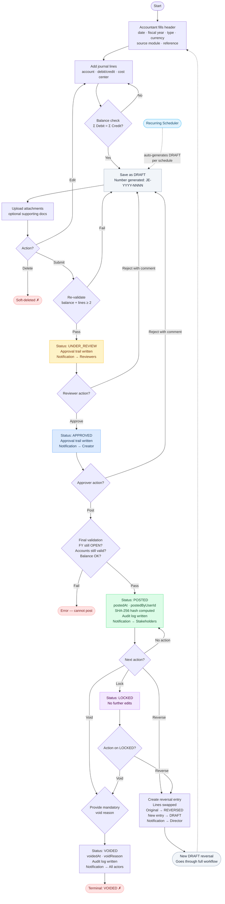

# Technical Design Document — Journal Entries Module

**Project:** Mans ERP
**Module:** Journal Entries (General Ledger)
**Version:** 2.0
**Date:** 2026-06-30
**Status:** As-Built + Planned Extensions (Phase 3 Baseline + Phase 3.1 Enhancements)
**Author:** Technical Architect

> This document is the authoritative technical reference for the Journal Entries module.
> No code change to this module may proceed without updating this document first.
> Approval is required before implementing any enhancement beyond this baseline.

### Changelog

| Version | Date | Changes |
|---|---|---|
| 1.0 | 2026-06-30 | Initial as-built document (Phase 3 baseline) |
| 2.0 | 2026-06-30 | Added: source tracking, attachments, approval history enhancements, SHA-256 integrity hash, notification interface, recurring journal architecture |

---

## 1. Database Tables

### 1.1 `journal_entries` (Primary Table)

| Column | Type | Nullable | Description |
|---|---|---|---|
| `id` | UUID PK | No | Auto-generated UUID |
| `organization_id` | UUID FK | No | Owning organization |
| `branch_id` | UUID FK | Yes | Optional branch scoping |
| `fiscal_year_id` | UUID FK | No | Must reference an OPEN fiscal year |
| `number` | String | No | Unique per org — `JE-{YEAR}-{SEQ}` |
| `entry_date` | Date | No | Date of the accounting event |
| `type` | Enum | No | MANUAL / AUTOMATIC / OPENING / CLOSING / ADJUSTMENT |
| `status` | Enum | No | See §6 — State Transitions |
| `currency_code` | String | No | Default: SAR |
| `exchange_rate` | Decimal(18,8) | No | Default: 1.0 |
| `total_debit` | Decimal(18,4) | No | Sum of all line debits |
| `total_credit` | Decimal(18,4) | No | Sum of all line credits (must equal total_debit) |
| `description_en` | String | Yes | English description |
| `description_ar` | String | Yes | Arabic description |
| `reference` | String | Yes | Primary external reference number (invoice, contract, PO, etc.) |
| `source_type` | String | Yes | **Source module identifier** — see §22 |
| `source_id` | UUID | Yes | **Source record UUID** in the originating module |
| `source_reference` | String | Yes | **Human-readable source reference** (e.g. invoice number, PO number) |
| `source_module_url` | String | Yes | **Deep-link URL** to the source record within the ERP |
| `integrity_hash` | String | Yes | **SHA-256 hash** computed at posting time — see §25 |
| `hash_algorithm` | String | Yes | Hash algorithm identifier — default: `SHA-256` |
| `hashed_at` | DateTime | Yes | Timestamp when hash was computed |
| `recurring_schedule_id` | UUID FK | Yes | FK to `journal_entry_recurring_schedules` — see §27 |
| `posted_at` | DateTime | Yes | Timestamp of posting |
| `posted_by_user_id` | UUID FK | Yes | User who posted |
| `voided_at` | DateTime | Yes | Timestamp of void |
| `voided_by_user_id` | UUID FK | Yes | User who voided |
| `void_reason` | String | Yes | Mandatory reason for void |
| `submitted_at` | DateTime | Yes | Timestamp of submission |
| `submitted_by_user_id` | UUID FK | Yes | User who submitted |
| `approved_at` | DateTime | Yes | Timestamp of approval |
| `approved_by_user_id` | UUID FK | Yes | User who approved |
| `is_reversal` | Boolean | No | True if this entry is a reversal |
| `reversal_of_entry_id` | UUID FK | Yes | The original entry this reverses |
| `reversed_by_entry_id` | UUID FK | Yes | The reversal entry (on the original) |
| `created_by_user_id` | UUID FK | Yes | User who created |
| `deleted_at` | DateTime | Yes | Soft-delete timestamp |
| `created_at` | DateTime | No | Record creation timestamp |
| `updated_at` | DateTime | No | Last update timestamp |

**Unique constraint:** `(organization_id, number)`

**Indexes:** `organization_id`, `fiscal_year_id`, `status`, `type`, `entry_date`, `source_type + source_id`, `recurring_schedule_id`, `deleted_at`

---

### 1.2 `journal_entry_lines` (Line Items)

| Column | Type | Nullable | Description |
|---|---|---|---|
| `id` | UUID PK | No | Auto-generated UUID |
| `journal_entry_id` | UUID FK | No | Parent journal entry |
| `account_id` | UUID FK | No | COA leaf account |
| `cost_center_id` | UUID FK | Yes | Optional cost center |
| `line_number` | Int | No | 1-based ordering |
| `description_en` | String | Yes | Line description (English) |
| `description_ar` | String | Yes | Line description (Arabic) |
| `debit` | Decimal(18,4) | No | Amount in transaction currency |
| `credit` | Decimal(18,4) | No | Amount in transaction currency |
| `debit_base` | Decimal(18,4) | No | `debit × exchange_rate` (SAR) |
| `credit_base` | Decimal(18,4) | No | `credit × exchange_rate` (SAR) |
| `reference` | String | Yes | Line-level reference |
| `created_at` | DateTime | No | — |
| `updated_at` | DateTime | No | — |

**Constraint:** On each line, exactly one of `debit` or `credit` must be > 0 (enforced at service layer).

**Indexes:** `journal_entry_id`, `account_id`, `cost_center_id`

---

### 1.3 `journal_entry_approvals` (Workflow Trail — Enhanced)

| Column | Type | Nullable | Description |
|---|---|---|---|
| `id` | UUID PK | No | — |
| `journal_entry_id` | UUID FK | No | Parent journal entry |
| `user_id` | UUID FK | No | Actor |
| `action` | String | No | SUBMIT / APPROVE / REJECT / POST / LOCK / VOID / REVERSE |
| `comment` | String | Yes | Optional note from the actor |
| `from_status` | String | Yes | Status before the action |
| `to_status` | String | Yes | Status after the action |
| `duration_seconds` | Int | Yes | **Seconds elapsed since the previous approval action** (computed on insert) |
| `ip_address` | String | Yes | **Actor's IP address** for security audit |
| `user_agent` | String | Yes | **Actor's browser/client** for security audit |
| `created_at` | DateTime | No | **Exact action timestamp (UTC)** — immutable |

**Purpose:** Full, immutable workflow audit trail per entry. Never updated or deleted.
See §24 for full approval history specification.

**Indexes:** `journal_entry_id`, `user_id`, `created_at`

---

### 1.4 `journal_entry_attachments` *(New)*

| Column | Type | Nullable | Description |
|---|---|---|---|
| `id` | UUID PK | No | Auto-generated UUID |
| `journal_entry_id` | UUID FK | No | Parent journal entry |
| `uploaded_by_user_id` | UUID FK | No | User who uploaded |
| `file_name` | String | No | Original filename as uploaded |
| `file_size_bytes` | Int | No | File size in bytes |
| `mime_type` | String | No | e.g. `application/pdf`, `image/jpeg` |
| `storage_key` | String | No | Object storage path/key — never exposed directly to clients |
| `storage_bucket` | String | No | Bucket or container name |
| `checksum_sha256` | String | No | SHA-256 hash of file content — for integrity verification |
| `description_en` | String | Yes | Optional description (English) |
| `description_ar` | String | Yes | Optional description (Arabic) |
| `is_primary` | Boolean | No | Default false — marks the primary supporting document |
| `deleted_at` | DateTime | Yes | Soft-delete (attachment removed, file may be purged) |
| `created_at` | DateTime | No | Upload timestamp |
| `updated_at` | DateTime | No | — |

**Constraints:**
- Maximum **10 attachments** per journal entry.
- Maximum file size: **20 MB** per file.
- Permitted MIME types: `application/pdf`, `image/jpeg`, `image/png`, `image/webp`, `application/vnd.openxmlformats-officedocument.spreadsheetml.sheet`, `application/vnd.ms-excel`.
- Only one attachment may have `is_primary = true` per entry (enforced at service layer).

**Indexes:** `journal_entry_id`, `uploaded_by_user_id`, `deleted_at`

---

### 1.5 `journal_entry_templates`

Reusable header + line skeletons. Stores `nameEn`, `nameAr`, `type`, `currencyCode`, and an array of `JournalEntryTemplateLine` rows. Used to pre-populate the create form.

---

### 1.6 `journal_entry_recurring_schedules` *(New)*

| Column | Type | Nullable | Description |
|---|---|---|---|
| `id` | UUID PK | No | Auto-generated UUID |
| `organization_id` | UUID FK | No | Owning organization |
| `name_en` | String | No | Schedule name (English) |
| `name_ar` | String | No | Schedule name (Arabic) |
| `description_en` | String | Yes | — |
| `description_ar` | String | Yes | — |
| `template_entry_id` | UUID FK | No | The source `JournalEntry` used as the generation template |
| `frequency` | Enum | No | DAILY / WEEKLY / MONTHLY / QUARTERLY / YEARLY |
| `interval` | Int | No | Repeat every N frequency units (e.g. `interval=2, frequency=MONTHLY` = every 2 months) |
| `day_of_week` | Int | Yes | 0=Sunday … 6=Saturday — for WEEKLY schedules |
| `day_of_month` | Int | Yes | 1–31 — for MONTHLY / QUARTERLY / YEARLY |
| `month_of_year` | Int | Yes | 1–12 — for YEARLY |
| `start_date` | Date | No | First generation date |
| `end_date` | Date | Yes | Optional end date (null = indefinite) |
| `max_occurrences` | Int | Yes | Optional cap on total generated entries |
| `occurrences_generated` | Int | No | Counter of entries generated so far |
| `last_generated_at` | DateTime | Yes | Timestamp of last successful generation run |
| `next_run_at` | DateTime | Yes | Pre-computed next scheduled run timestamp |
| `status` | Enum | No | ACTIVE / PAUSED / COMPLETED / CANCELLED |
| `auto_submit` | Boolean | No | Auto-submit generated entries for review |
| `auto_approve` | Boolean | No | Auto-approve (requires `auto_submit = true`) |
| `created_by_user_id` | UUID FK | No | — |
| `deleted_at` | DateTime | Yes | Soft-delete |
| `created_at` | DateTime | No | — |
| `updated_at` | DateTime | No | — |

**Enum — RecurringScheduleStatus:** ACTIVE, PAUSED, COMPLETED, CANCELLED

**Enum — RecurringFrequency:** DAILY, WEEKLY, MONTHLY, QUARTERLY, YEARLY

**Indexes:** `organization_id`, `status`, `next_run_at`, `deleted_at`

---

### 1.7 Supporting Tables (referenced)

| Table | Role |
|---|---|
| `fiscal_years` | Determines valid posting period; must be OPEN |
| `chart_of_accounts` | Validates account eligibility at every write |
| `cost_centers` | Optional dimension on every line |
| `audit_logs` | Platform-wide immutable event log |
| `notifications` | Workflow event notifications — see §26 |

---

## 2. API Endpoints

All endpoints are authenticated via Clerk (`requireAuth()`). All request bodies are validated with Zod before any database operation.

### 2.1 Journal Entry Core Endpoints

| Method | Path | Description | Auth |
|---|---|---|---|
| `GET` | `/api/journal-entries` | Paginated list with filters | Required |
| `GET` | `/api/journal-entries/:id` | Full detail with lines, approvals, attachments, and relations | Required |
| `POST` | `/api/journal-entries` | Create new draft | Required |
| `PATCH` | `/api/journal-entries/:id` | Update DRAFT or UNDER_REVIEW entry | Required |
| `DELETE` | `/api/journal-entries/:id` | Soft-delete DRAFT entry | Required |
| `POST` | `/api/journal-entries/:id/submit` | DRAFT → UNDER_REVIEW | Required |
| `POST` | `/api/journal-entries/:id/approve` | UNDER_REVIEW → APPROVED | Required |
| `POST` | `/api/journal-entries/:id/reject` | UNDER_REVIEW or APPROVED → DRAFT | Required |
| `POST` | `/api/journal-entries/:id/post` | APPROVED → POSTED + hash computed | Required |
| `POST` | `/api/journal-entries/:id/lock` | POSTED → LOCKED | Required |
| `POST` | `/api/journal-entries/:id/void` | POSTED or LOCKED → VOIDED | Required |
| `POST` | `/api/journal-entries/:id/reverse` | POSTED or LOCKED → creates reversal entry | Required |
| `POST` | `/api/journal-entries/:id/copy` | Any status → creates new DRAFT copy | Required |

### 2.2 Attachment Endpoints *(New)*

| Method | Path | Description | Auth |
|---|---|---|---|
| `GET` | `/api/journal-entries/:id/attachments` | List all non-deleted attachments for an entry | Required |
| `POST` | `/api/journal-entries/:id/attachments` | Upload a new attachment (`multipart/form-data`) | Required |
| `PATCH` | `/api/journal-entries/:id/attachments/:attachId` | Update description or `is_primary` flag | Required |
| `GET` | `/api/journal-entries/:id/attachments/:attachId/download` | Generate a short-lived signed download URL | Required |
| `DELETE` | `/api/journal-entries/:id/attachments/:attachId` | Soft-delete an attachment | Required |

**Upload request fields:**

| Field | Type | Required | Notes |
|---|---|---|---|
| `file` | Binary | Yes | Multipart file field |
| `descriptionEn` | String | No | — |
| `descriptionAr` | String | No | — |
| `isPrimary` | Boolean | No | Default: false |

**Upload response:**
```json
{
  "id": "uuid",
  "fileName": "invoice-Q1-2026.pdf",
  "fileSizeBytes": 204800,
  "mimeType": "application/pdf",
  "checksumSha256": "e3b0c44...",
  "isPrimary": false,
  "createdAt": "2026-06-30T12:00:00Z"
}
```

**Download response:**
```json
{
  "url": "https://storage.example.com/signed-url?token=...",
  "expiresAt": "2026-06-30T12:15:00Z"
}
```
Signed URLs expire after **15 minutes**. The raw `storage_key` is never returned to clients.

### 2.3 Approval History Endpoint *(Enhanced)*

| Method | Path | Description | Auth |
|---|---|---|---|
| `GET` | `/api/journal-entries/:id/approvals` | Full approval history with actors, timestamps, and comments | Required |

**Response shape:**
```json
{
  "data": [
    {
      "id": "uuid",
      "action": "SUBMIT",
      "fromStatus": "DRAFT",
      "toStatus": "UNDER_REVIEW",
      "comment": null,
      "durationSeconds": null,
      "createdAt": "2026-06-30T09:00:00Z",
      "user": { "id": "uuid", "firstNameEn": "Sara", "lastNameEn": "Ahmed", "email": "sara@org.sa" }
    },
    {
      "id": "uuid",
      "action": "APPROVE",
      "fromStatus": "UNDER_REVIEW",
      "toStatus": "APPROVED",
      "comment": "Verified against PO-2026-0042",
      "durationSeconds": 3720,
      "createdAt": "2026-06-30T10:02:00Z",
      "user": { "id": "uuid", "firstNameEn": "Khalid", "lastNameEn": "Ali", "email": "khalid@org.sa" }
    }
  ]
}
```

### 2.4 Recurring Schedule Endpoints *(New)*

| Method | Path | Description | Auth |
|---|---|---|---|
| `GET` | `/api/journal-entries/recurring` | List all recurring schedules for the org | Required |
| `POST` | `/api/journal-entries/recurring` | Create a new recurring schedule | Required |
| `GET` | `/api/journal-entries/recurring/:scheduleId` | Get schedule detail with generated entries | Required |
| `PATCH` | `/api/journal-entries/recurring/:scheduleId` | Update schedule (pause, change dates, etc.) | Required |
| `POST` | `/api/journal-entries/recurring/:scheduleId/pause` | Pause an ACTIVE schedule | Required |
| `POST` | `/api/journal-entries/recurring/:scheduleId/resume` | Resume a PAUSED schedule | Required |
| `POST` | `/api/journal-entries/recurring/:scheduleId/cancel` | Cancel the schedule | Required |
| `DELETE` | `/api/journal-entries/recurring/:scheduleId` | Soft-delete a CANCELLED schedule | Required |

### 2.5 Query Parameters — GET /api/journal-entries

| Parameter | Type | Description |
|---|---|---|
| `search` | String | Matches number, descriptionEn, descriptionAr, reference, sourceReference |
| `status` | Enum | Filter by status |
| `type` | Enum | Filter by type |
| `organizationId` | UUID | Scoping (defaults to user's org) |
| `fiscalYearId` | UUID | Filter by fiscal year |
| `sourceType` | String | Filter by source module (e.g. `bank_transaction`) |
| `sourceId` | UUID | Filter by specific source record |
| `startDate` | Date | `entryDate ≥ startDate` |
| `endDate` | Date | `entryDate ≤ endDate` |
| `page` | Int | Default: 1 |
| `pageSize` | Int | Default: 20, max: 100 |

### 2.6 Response Shape — List

```json
{
  "data": [ { ...JournalEntry, createdBy, fiscalYear, _count: { lines, attachments } } ],
  "meta": { "page": 1, "pageSize": 20, "total": 145, "totalPages": 8 }
}
```

---

## 3. UI Pages

### 3.1 `/journal-entries` — List Page (`JournalEntries.tsx`)

| State | Implementation |
|---|---|
| **Loading** | Full-table skeleton rows (8 rows × 10 columns) |
| **Empty** | Icon + message + "New Entry" CTA button |
| **Error** | Toast notification with error message |
| **Success** | Paginated table with status tabs |
| **Responsive** | Horizontal scroll on narrow viewports |

**Features:**
- Status tab bar: ALL / DRAFT / UNDER_REVIEW / APPROVED / POSTED / LOCKED / REVERSED
- Type filter dropdown
- Source module filter dropdown *(planned — see §22)*
- Debounced search (400ms) on number, description, reference, source reference
- Row click → navigate to detail
- Hover-revealed action menu: View, Edit (DRAFT/UNDER_REVIEW only), Submit (DRAFT only), Copy, Delete (DRAFT only)
- Attachment count badge on rows that have attachments *(planned)*
- Pagination controls with page counter
- REV badge on reversal entries

---

### 3.2 `/journal-entries/new` and `/journal-entries/:id/edit` — Form Page (`JournalEntryForm.tsx`)

| State | Implementation |
|---|---|
| **Loading (edit)** | Skeleton while loading existing entry |
| **Empty lines** | Minimum 2 lines enforced |
| **Balance indicator** | Live green (balanced) / red (unbalanced) / grey (empty) bar |
| **Error** | Toast + disabled submit while unbalanced |
| **Success** | Toast + redirect to detail |

**Features:**
- Header fields: date, fiscal year (OPEN only), type, currency, exchange rate, descriptions (EN + AR), reference
- Source fields: source type, source reference, source module URL *(planned — see §22)*
- Line table: account combobox (searchable, leaf accounts only), description, cost center, debit, credit
- Attachment uploader section on the form *(planned — see §23)*
- Account combobox: filtered to `isActive=true`, `isGroup=false`, `allowDirectEntry=true`
- Debit/credit mutual exclusivity (entering debit clears credit and vice versa)
- Live running totals in tfoot
- Minimum 2 lines; delete disabled when count = 2
- Edit mode: blocks navigation if entry is not DRAFT or UNDER_REVIEW

---

### 3.3 `/journal-entries/:id` — Detail Page (`JournalEntryDetail.tsx`)

| State | Implementation |
|---|---|
| **Loading** | Skeleton layout |
| **Not found** | Error message with back button |
| **Error** | Error message |
| **Success** | Full detail with all workflow actions |

**Features:**
- Header card: all metadata, timestamps, actors, source module link
- Lines table: account code + name, cost center, debit, credit (base amounts if foreign currency)
- **Attachments panel**: file list with name, size, type, uploader, upload date, download button *(planned)*
- **Approval history timeline**: chronological list with actor, action, timestamp, duration, comment *(planned — see §24)*
- **Integrity badge**: hash value and timestamp shown after posting *(planned — see §25)*
- Reversal badge + link to/from related entry
- Contextual action buttons (status-driven visibility)
- Copy action available from any status

---

## 4. User Workflow

```
Accountant creates draft → optionally attaches supporting documents → submits for review
                                  ↓
Reviewer reviews entry + attachments → approves with comment (or rejects back to draft)
                                  ↓
Accountant/Manager posts the approved entry
   → SHA-256 integrity hash computed and stored
   → Workflow notifications sent
                                  ↓
Entry is now permanent in the ledger
                                  ↓
  [Optional] Supervisor locks the entry
  [Optional] Authorized user voids or reverses
```

---

## 5. Journal Entry Lifecycle

```
Create  →  DRAFT  →  Submit  →  UNDER_REVIEW  →  Approve  →  APPROVED  →  Post  →  POSTED
                  ↑                          ↓                         ↓              ↓    ↓
                  └──────── Reject ──────────┘                         │           Lock  Void/Reverse
                                                                        └── Reject →
                                                                            DRAFT
```

**Terminal states:** VOIDED, LOCKED (cannot transition further except LOCKED → VOIDED or LOCKED → REVERSED)

---

## 6. State Transitions

| From | Action | To | Guard |
|---|---|---|---|
| *(none)* | Create | DRAFT | Fiscal year OPEN; balanced; valid accounts |
| DRAFT | Edit | DRAFT | Status is DRAFT or UNDER_REVIEW |
| DRAFT | Delete | *(soft-deleted)* | Status must be DRAFT |
| DRAFT | Submit | UNDER_REVIEW | ≥ 2 lines; balanced |
| UNDER_REVIEW | Approve | APPROVED | Status must be UNDER_REVIEW |
| UNDER_REVIEW | Reject | DRAFT | Clears submittedAt, approvedAt |
| APPROVED | Reject | DRAFT | Clears approvedAt |
| APPROVED | Post | POSTED | Fiscal year still OPEN; re-validates accounts; re-validates balance; **computes SHA-256 hash** |
| POSTED | Lock | LOCKED | Status must be POSTED |
| POSTED | Void | VOIDED | Requires void reason |
| POSTED | Reverse | POSTED (new entry) | Creates a new reversal entry in DRAFT |
| LOCKED | Void | VOIDED | Requires void reason |
| LOCKED | Reverse | POSTED (new entry) | Creates a new reversal entry in DRAFT |

**Immutability rule:** POSTED, LOCKED, VOIDED, and REVERSED entries cannot be edited or deleted.

---

## 7. Validation Rules

### 7.1 Header Validation (Zod schema — enforced on create and update)

| Field | Rule |
|---|---|
| `fiscalYearId` | Required; must exist; must belong to same org; must be `status = OPEN` |
| `entryDate` | Required; format `YYYY-MM-DD` |
| `type` | One of: MANUAL, AUTOMATIC, OPENING, CLOSING, ADJUSTMENT |
| `currencyCode` | String (SAR default) |
| `exchangeRate` | Positive number, default 1.0 |
| `lines` | Minimum 2 items |
| `sourceType` | Optional; if provided, must be a registered module identifier (see §22) |
| `sourceId` | Optional UUID; required when `sourceType` is provided |
| `sourceReference` | Optional string; max 255 chars |

### 7.2 Line Validation (per line)

| Field | Rule |
|---|---|
| `accountId` | Required; valid UUID; account exists in org; `isActive=true`; `isGroup=false`; `allowDirectEntry=true` |
| `lineNumber` | Positive integer |
| `debit` | ≥ 0, Decimal |
| `credit` | ≥ 0, Decimal |
| `costCenterId` | Optional UUID; if provided, must exist |

### 7.3 Double-Entry Balance Rule

```
abs(Σ debit − Σ credit) < 0.01
```

Checked on: Create, Update (if lines provided), Submit, Post.

### 7.4 Account Eligibility (enforced at service layer)

An account may only be used in a journal entry line if **all three** conditions are met:
1. `isActive = true`
2. `isGroup = false`
3. `allowDirectEntry = true`

### 7.5 Fiscal Year Gate

The fiscal year must be `status = OPEN` at the time of:
- Create
- Post (re-checked — fiscal year may have been closed after approval)

### 7.6 Attachment Validation

| Rule | Detail |
|---|---|
| Max files per entry | 10 (including soft-deleted ones excluded from count) |
| Max file size | 20 MB per file |
| Permitted MIME types | `application/pdf`, `image/jpeg`, `image/png`, `image/webp`, `.xlsx`, `.xls` |
| Filename | Sanitized server-side; original name stored in `file_name` |
| Checksum | SHA-256 computed server-side after upload; stored in `checksum_sha256` |
| `is_primary` | At most one per entry; enforced by un-setting previous primary on new primary upload |

---

## 8. Posting Workflow

When `POST /api/journal-entries/:id/post` is called:

1. Resolve entry (must exist, not soft-deleted).
2. Assert `status = APPROVED` → 400 if not.
3. Assert `lines.length ≥ 2` → 400 if not.
4. Re-validate double-entry balance → 400 if unbalanced.
5. Re-fetch fiscal year → assert `status = OPEN` → 400 if closed.
6. For every line, re-assert account `isActive` and `!isGroup` → 400 if violated.
7. **Compute SHA-256 integrity hash** (see §25 for input specification).
8. Update `status = POSTED`, `postedAt = now()`, `postedByUserId = user.id`, `integrityHash`, `hashAlgorithm = 'SHA-256'`, `hashedAt = now()`.
9. Write `JournalEntryApproval` record: action=`POST`, from=`APPROVED`, to=`POSTED`.
10. Write `AuditLog`: action=`POST`.
11. **Emit workflow notification event** (see §26): event=`journal_entry.posted`.
12. Return updated entry.

**Idempotency:** Calling post on an already-POSTED entry returns 400, not 200.

---

## 9. Reversal Entry Workflow

When `POST /api/journal-entries/:id/reverse` is called:

1. Resolve original entry (must be POSTED or LOCKED).
2. Assert original is not already reversed (`reversedByEntryId` is null) → 409 if already reversed.
3. Generate a new journal number for the reversal.
4. Create a new `JournalEntry` in `DRAFT` status with:
   - `isReversal = true`
   - `reversalOfEntryId = original.id`
   - Same fiscal year, currency, exchange rate
   - `entryDate` = today (or caller-supplied date)
   - Lines: each original line with **debit and credit swapped**
   - `descriptionEn` = `"Reversal of {original.number}"`
   - `descriptionAr` = `"عكس القيد {original.number}"`
   - `sourceType`, `sourceId`, `sourceReference` copied from original
5. Update original entry: `reversedByEntryId = newEntry.id`, `status = REVERSED`.
6. Write `JournalEntryApproval` on original: action=`REVERSE`.
7. Write `AuditLog` on both entries.
8. **Emit notification event**: `journal_entry.reversed`.
9. Return the new reversal entry.

**Note:** The reversal entry itself must go through the full workflow (submit → approve → post) before it affects the ledger.

---

## 10. Approval Workflow

### Roles and Permitted Actions

| Action | Permitted Roles |
|---|---|
| Create / Edit | Accountant, Accounting Manager, Admin |
| Submit | Accountant, Accounting Manager, Admin |
| Approve | Accounting Manager, Finance Director, Admin |
| Reject | Accounting Manager, Finance Director, Admin |
| Post | Accounting Manager, Finance Director, Admin |
| Lock | Finance Director, Admin |
| Void | Finance Director, Admin |
| Reverse | Finance Director, Admin |
| View | All authenticated users |

> RBAC enforcement is pending full role implementation (Phase 1 enhancement). Currently all authenticated users may perform all actions.

### Approval Record

Every workflow transition writes a `JournalEntryApproval` row with the actor, action, comment, duration, IP, user agent, and status transition. This record is immutable and is the audit trail for governance and regulatory purposes.

See §24 for the full specification of approval history display and computation.

---

## 11. Numbering Strategy

**Format:** `JE-{YYYY}-{NNNN}`

**Examples:** `JE-2025-0001`, `JE-2025-0142`, `JE-2026-0001`

**Algorithm:**
1. Determine `year` from `entryDate`.
2. Query all `JournalEntry` records for the same `organizationId` where `number LIKE 'JE-{year}-%'`.
3. Parse the numeric suffix from each match.
4. Take `max + 1`, left-pad to 4 digits.
5. Result is `JE-{year}-{padded}`.

**Scope:** Number sequence resets per calendar year. Unique per `(organizationId, number)`.

**Known limitation:** The current approach is not atomic under high concurrency. A database sequence or advisory lock should replace it in a future sprint (see §20).

---

## 12. Permission Matrix

| Action | Accountant | Acct. Manager | Finance Director | Auditor | Admin |
|---|---|---|---|---|---|
| View list | ✓ | ✓ | ✓ | ✓ | ✓ |
| View detail | ✓ | ✓ | ✓ | ✓ | ✓ |
| View attachments | ✓ | ✓ | ✓ | ✓ | ✓ |
| Upload attachments | ✓ | ✓ | ✓ | — | ✓ |
| Delete attachments | ✓ | ✓ | ✓ | — | ✓ |
| View approval history | ✓ | ✓ | ✓ | ✓ | ✓ |
| Create (draft) | ✓ | ✓ | ✓ | — | ✓ |
| Edit (draft) | ✓ | ✓ | ✓ | — | ✓ |
| Delete (draft) | ✓ | ✓ | ✓ | — | ✓ |
| Submit | ✓ | ✓ | ✓ | — | ✓ |
| Approve | — | ✓ | ✓ | — | ✓ |
| Reject | — | ✓ | ✓ | — | ✓ |
| Post | — | ✓ | ✓ | — | ✓ |
| Lock | — | — | ✓ | — | ✓ |
| Void | — | — | ✓ | — | ✓ |
| Reverse | — | — | ✓ | — | ✓ |
| Copy | ✓ | ✓ | ✓ | ✓ | ✓ |
| Export | ✓ | ✓ | ✓ | ✓ | ✓ |
| Manage recurring schedules | — | ✓ | ✓ | — | ✓ |
| Verify integrity hash | ✓ | ✓ | ✓ | ✓ | ✓ |

---

## 13. Error Handling

### HTTP Status Codes

| Situation | Code | Message Pattern |
|---|---|---|
| Invalid request body | 400 | `"Validation failed"` + Zod flatten |
| Business rule violation | 400 | Specific message (e.g. `"Entry is not balanced"`) |
| User not found in DB | 401 | `"User not found"` |
| Record not found | 404 | `"Journal entry not found"` |
| Status conflict | 400 | `"Cannot {action} a {status} entry"` |
| Already reversed | 409 | `"Entry has already been reversed"` |
| Attachment limit exceeded | 400 | `"Maximum of 10 attachments per entry"` |
| Attachment too large | 400 | `"File exceeds the 20 MB limit"` |
| Unsupported file type | 400 | `"File type {mimeType} is not permitted"` |
| Hash mismatch on verify | 409 | `"Integrity hash does not match — entry may have been tampered with"` |
| Internal error | 500 | `"Failed to {action} journal entry"` |

### Frontend Error Handling

- Network / API errors → destructive toast with error message from `err.response.data.error`
- Validation errors → toast before API call (balance check, empty accounts)
- Status conflicts → toast + redirect (e.g. editing a non-editable entry redirects to detail)
- Upload errors → inline error on the attachment uploader component
- All mutations wrapped in `onError` handlers; no silent failures

---

## 14. Audit Events

Every operation on a journal entry writes to the `audit_logs` table.

| Operation | Audit Action | Entity Type | Description |
|---|---|---|---|
| Create | `CREATE` | `journal_entry` | `"Created journal entry {number}"` |
| Update | `UPDATE` | `journal_entry` | `"Updated journal entry {number}"` |
| Delete | `DELETE` | `journal_entry` | `"Deleted draft {number}"` |
| Submit | — | — | Written as `JournalEntryApproval` only |
| Approve | `APPROVE` | `journal_entry` | `"Approved {number}"` |
| Reject | `REJECT` | `journal_entry` | `"Rejected {number}: {comment}"` |
| Post | `POST` | `journal_entry` | `"Posted {number} — hash: {first16chars}..."` |
| Lock | — | — | Written as `JournalEntryApproval` only |
| Void | `VOID` | `journal_entry` | `"Voided {number}: {reason}"` |
| Reverse | `CREATE` × 2 | `journal_entry` | On both original and reversal |
| Copy | `CREATE` | `journal_entry` | `"Copied from {source.number}"` |
| Upload attachment | `CREATE` | `journal_entry_attachment` | `"Uploaded {fileName} to {number}"` |
| Delete attachment | `DELETE` | `journal_entry_attachment` | `"Deleted attachment {fileName} from {number}"` |
| Schedule created | `CREATE` | `recurring_schedule` | `"Created recurring schedule {name}"` |
| Schedule generated entry | `CREATE` | `journal_entry` | `"Auto-generated from schedule {scheduleId}"` |

All audit log entries include: `userId`, `userEmail`, `action`, `entityType`, `entityId`, `oldValues`, `newValues`, `description`.

---

## 15. Sequence Diagrams

### 15.1 Create → Post (Happy Path)

```
Accountant        API Server                   Database
    │                  │                           │
    │── POST /je ──────►│                           │
    │                  │── validateFiscalYear() ───►│
    │                  │◄── FY: OPEN ───────────────│
    │                  │── validateBalance() ───────│ (in-memory)
    │                  │── validateAccounts() ──────►│
    │                  │◄── accounts: valid ─────────│
    │                  │── generateNumber() ─────────►│
    │                  │◄── JE-2026-0001 ─────────────│
    │                  │── journalEntry.create() ─────►│
    │                  │── auditLog.create() ──────────►│
    │◄── 201 DRAFT ─────│                           │
    │                  │                           │
    │── POST /:id/submit►│                           │
    │                  │── validateBalance() ───────│
    │                  │── journalEntry.update() ────►│ status=UNDER_REVIEW
    │                  │── approval.create() ─────────►│ action=SUBMIT
    │◄── 200 UNDER_REVIEW│                           │
    │                  │                           │
Manager           API Server                   Database
    │── POST /:id/approve►│                           │
    │                  │── journalEntry.update() ────►│ status=APPROVED
    │                  │── approval.create() ─────────►│ action=APPROVE
    │                  │── auditLog.create() ──────────►│
    │◄── 200 APPROVED ──│                           │
    │                  │                           │
    │── POST /:id/post ─►│                           │
    │                  │── re-validate balance ─────│
    │                  │── re-validate FY.status ───►│
    │                  │── re-validate accounts ─────►│
    │                  │── computeSHA256(entry) ────│ (in-memory)
    │                  │── journalEntry.update() ────►│ status=POSTED + hash
    │                  │── approval.create() ─────────►│ action=POST
    │                  │── auditLog.create() ──────────►│
    │                  │── notificationService.emit()──│ journal_entry.posted
    │◄── 200 POSTED ────│                           │
```

---

### 15.2 Reversal Flow

```
Director          API Server                   Database
    │── POST /:id/reverse►│                           │
    │                  │── fetch original ───────────►│
    │                  │◄── POSTED, not reversed ──────│
    │                  │── generateNumber() ──────────►│ JE-2026-0098
    │                  │── journalEntry.create() ──────►│ isReversal=true, DRAFT
    │                  │── journalEntry.update(orig) ──►│ status=REVERSED
    │                  │── approval.create() ──────────►│ REVERSE
    │                  │── auditLog × 2 ───────────────►│
    │                  │── notificationService.emit() ──│ journal_entry.reversed
    │◄── 201 new DRAFT ─│                           │
    │                  │                           │
    │   [New reversal entry must go through full workflow before ledger effect]
```

---

### 15.3 Attachment Upload Flow *(New)*

```
Accountant        API Server              Object Storage        Database
    │                  │                       │                    │
    │── POST /attachments (multipart) ─────────►│                   │
    │                  │── validateMime() ──────│                   │
    │                  │── validateSize() ──────│                   │
    │                  │── computeSHA256(file) ─│                   │
    │                  │── storage.upload() ────►│                  │
    │                  │◄── storageKey ──────────│                  │
    │                  │── attachment.create() ──────────────────────►│
    │                  │── auditLog.create() ────────────────────────►│
    │◄── 201 attachment ─│                       │                   │
    │                  │                       │                    │
    │── GET /attachments/:id/download ──────────►│                   │
    │                  │── generateSignedUrl(storageKey, 15min) ────►│
    │                  │◄── signed URL ──────────│                  │
    │◄── { url, expiresAt } ────────────────────│                   │
```

---

### 15.4 Recurring Schedule Generation Flow *(New)*

```
Scheduler         API Server                   Database
(cron/job runner)      │                           │
    │                  │                           │
    │── GET due schedules ──────────────────────────►│ next_run_at ≤ NOW, status=ACTIVE
    │◄── [scheduleA, scheduleB, ...] ───────────────│
    │                  │                           │
    │── for each schedule:                          │
    │   │── fetch templateEntry ─────────────────────►│
    │   │── clone entry (status=DRAFT) ──────────────►│
    │   │── if auto_submit: POST /:id/submit ─────────►│
    │   │── if auto_approve: POST /:id/approve ───────►│
    │   │── update schedule.next_run_at ──────────────►│
    │   │── update schedule.occurrences_generated++ ──►│
    │   │── if max_occurrences reached: status=COMPLETED►│
    │   │── auditLog.create() ───────────────────────►│
    │   │── notificationService.emit() ──────────────│ journal_entry.recurring_generated
    │◄── done ─────────────────────────────────────│
```

---

## 16. Edge Cases

| Scenario | Handling |
|---|---|
| Fiscal year closed between approval and posting | Re-check at POST time → 400 if closed |
| Account deactivated between creation and posting | Re-check at POST time → 400 per inactive account |
| Duplicate submit (network retry) | 400 — entry is already UNDER_REVIEW |
| Reversal of a reversed entry | 409 — `reversedByEntryId` is already set |
| Posting with zero amounts | Balance check: `totalDebit > 0` required |
| 2-line minimum violation | Rejected at Zod schema level (min(2)) and re-checked at submit/post |
| Non-SAR currency with exchangeRate=1 | Allowed; debitBase = debit, creditBase = credit |
| Entry date in closed fiscal year period | Fiscal year validity is checked — if FY is OPEN, any date within the FY is valid |
| Copy of a VOIDED entry | Allowed — creates clean DRAFT (not marked as reversal) |
| Concurrent number generation | Race condition possible — must be resolved with DB sequence in future (§20) |
| Delete with lines | Soft-delete only; cascade is not triggered (`deletedAt` set on header only) |
| Upload to POSTED entry | Attachments are permitted on any status; they do not affect immutability of accounting data |
| `sourceId` without `sourceType` | Rejected at validation — both must be provided together |
| Recurring schedule with closed fiscal year | Generator skips run and logs warning; next run re-attempted on next cycle |
| `max_occurrences` reached mid-cycle | Schedule set to COMPLETED; no further entries generated |
| SHA-256 hash computed on already-posted entry | Hash is idempotent — same input always yields same hash; hash is stored once at posting time and never recomputed |
| Attachment file corrupted in storage | Checksum mismatch detected on download verification → client notified |

---

## 17. Testing Strategy

### 17.1 Unit Tests (Service Layer)

| Test | Assertion |
|---|---|
| `validateBalance` — equal amounts | Returns `balanced = true` |
| `validateBalance` — unequal amounts | Returns `balanced = false` |
| `validateBalance` — within 0.01 tolerance | Returns `balanced = true` |
| `generateJournalNumber` — first entry | Returns `JE-2026-0001` |
| `generateJournalNumber` — 10th entry | Returns `JE-2026-0010` |
| `generateJournalNumber` — year rollover | Returns `JE-2027-0001` |
| `validateAccounts` — inactive account | Returns error message |
| `validateAccounts` — group account | Returns error message |
| `validateAccounts` — no direct entry | Returns error message |
| `validateAccounts` — valid account | Returns empty array |
| `computeIntegrityHash` — known input | Returns known SHA-256 hex string |
| `computeIntegrityHash` — mutation detected | Hash mismatch when input changes |
| `computeNextRunAt` — MONTHLY schedule | Returns correct next month date |
| `computeNextRunAt` — end of month handling | Day 31 falls to last day of shorter months |
| `validateAttachment` — invalid MIME | Returns error |
| `validateAttachment` — size exceeded | Returns error |

### 17.2 Integration Tests (API Layer)

| Test | Scenario |
|---|---|
| POST `/journal-entries` | Valid payload → 201, correct number format |
| POST `/journal-entries` | Unbalanced → 400 |
| POST `/journal-entries` | Closed fiscal year → 400 |
| POST `/journal-entries` | Group account → 400 |
| PATCH `/:id` | Edit POSTED entry → 400 |
| POST `/:id/submit` | From DRAFT → 200, status=UNDER_REVIEW |
| POST `/:id/submit` | From POSTED → 400 |
| POST `/:id/approve` | From UNDER_REVIEW → 200, status=APPROVED |
| POST `/:id/post` | From APPROVED → 200, status=POSTED, hash populated |
| POST `/:id/post` | Fiscal year closed after approval → 400 |
| POST `/:id/reverse` | POSTED entry → 201 reversal, original=REVERSED |
| POST `/:id/reverse` | Already reversed → 409 |
| DELETE `/:id` | DRAFT entry → 200, soft-deleted |
| DELETE `/:id` | POSTED entry → 400 |
| GET `/` | Pagination meta correct |
| GET `/:id` | Includes lines, approvals, attachments, actors |
| POST `/:id/attachments` | Valid PDF → 201, checksum stored |
| POST `/:id/attachments` | Exceeds 10-file limit → 400 |
| POST `/:id/attachments` | Invalid MIME → 400 |
| GET `/:id/attachments/:attachId/download` | Returns signed URL with expiry |
| GET `/:id/approvals` | Returns full history with durations and comments |
| POST `/recurring` | Valid schedule → 201 |
| POST `/recurring/:scheduleId/pause` | ACTIVE → 200, status=PAUSED |

### 17.3 Frontend Tests (E2E — Playwright)

| Test | Scenario |
|---|---|
| Navigate to `/journal-entries` | Page loads, status tabs visible |
| All 5 UI states | Loading, empty, error, success, responsive |
| Create form | Balance indicator turns green when balanced |
| Create form | Submit blocked when unbalanced |
| Create form | Account combobox filters leaf accounts only |
| List page | Row click navigates to detail |
| Detail page | Correct action buttons per status |
| Detail page | Reversal badge and link shown |
| Detail page | Integrity hash shown after posting |
| Detail page | Attachments panel lists files |
| Attachment upload | File uploads successfully and appears in list |
| Attachment download | Signed URL returned and download initiated |
| Approval history | Timeline shows all events with timestamps |

---

## 18. Performance Considerations

| Concern | Mitigation |
|---|---|
| List query on large orgs | Indexes on `organization_id`, `status`, `entry_date`; pagination enforced (max 100/page) |
| Account combobox (500 accounts) | Fetched once on mount; filtered client-side; Command component handles virtualization |
| Approval history | Eager-loaded in a single JOIN on `GET /:id` — no N+1 |
| Balance validation | In-memory arithmetic — no DB query |
| Account validation | One DB query per line (N queries) — acceptable for typical entries (2–20 lines); can be batched in future |
| Number generation | Full table scan on number prefix — acceptable at current scale; replace with DB sequence for >10k entries/org/year |
| Lines replace on update | Delete-all + create-all per update (not atomic diff) — acceptable for ≤ 50 lines |
| SHA-256 hash computation | Computed in-memory at post time; negligible overhead for entry sizes in scope |
| Attachment storage | Files stored in object storage, not database; only metadata in PostgreSQL |
| Signed URL generation | Computed on demand per download request; no caching to avoid stale access after soft-delete |
| Recurring schedule scanner | Background job scans on `next_run_at ≤ NOW AND status = ACTIVE` — indexed; runs outside request cycle |

---

## 19. Security Considerations

| Concern | Control |
|---|---|
| Unauthenticated access | `requireAuth()` middleware on all endpoints |
| Cross-org data access | All queries scoped by `organizationId` derived from authenticated user |
| Mass assignment | All inputs validated through Zod schemas; no `req.body` spread into DB |
| Sensitive data in responses | No password, token, or internal system fields exposed |
| Void/reverse abuse | Status guards — cannot void DRAFT or APPROVED; cannot reverse VOIDED |
| Audit trail tampering | `JournalEntryApproval` rows have no update/delete API |
| SQL injection | All queries through Prisma parameterized API — no raw SQL in this module |
| Immutability of posted entries | Edit and delete guards check status before any mutation |
| Fiscal year enforcement | Checked at both create and post — gap between approval and posting is covered |
| Attachment path traversal | `storage_key` computed server-side; original filename sanitized; raw key never returned to client |
| Attachment access control | Download requires authentication; signed URL is scoped and time-limited (15 min) |
| File content safety | MIME type validated against allowlist; file content scanned for MIME spoofing |
| Integrity hash | SHA-256 stored at post time; any database-level tampering is detectable by re-computing the hash |
| Recurring schedule abuse | Only Accounting Manager and above may create/modify schedules; `auto_approve` requires explicit role |

---

## 20. Future Extensibility

| Enhancement | Priority | Notes |
|---|---|---|
| Full RBAC enforcement | High | Permission matrix (§12) is defined; awaits role middleware implementation |
| Atomic number generation | High | Replace prefix-scan with PostgreSQL `SEQUENCE` per org/year |
| Batch account validation | Medium | Replace per-line queries with single `findMany` + Map lookup |
| Ledger balance updates | High | Real-time `account_balances` materialized view updated on POST |
| Period-close automation | Medium | Bulk LOCK of all POSTED entries when fiscal period closes |
| Foreign currency revaluation | Low | Revaluation journal entries for open balances at period-end |
| Import from Excel/CSV | Low | Bulk journal entry creation |
| Export to PDF/Excel | Medium | Formatted journal voucher document |
| Intercompany entries | Low | Cross-organization journal entries |
| Multi-level approval chains | Medium | Configurable approval chains (e.g. Manager → Director for amounts > 100k SAR) |
| Attachment virus scanning | High | Integrate antivirus scan on upload before storing |
| Attachment OCR | Low | Extract text from PDF/image attachments for searchability |
| Hash blockchain anchoring | Low | Anchor SHA-256 hash to a public ledger for external tamper-evidence |
| Push notifications | Medium | Real-time in-app notification delivery (WebSocket / SSE) |
| Email digest | Low | Daily digest of pending approvals per reviewer |

---

## 22. External Reference and Source Module Tracking *(New)*

### Purpose

Journal entries are often generated by or linked to records in other ERP modules (bank transactions, donation receipts, procurement invoices, payroll runs, etc.). The source tracking fields on `journal_entries` provide a structured, queryable link back to the originating record.

### Source Field Specification

| Field | Column | Purpose |
|---|---|---|
| `sourceType` | `source_type` | String identifier for the originating module |
| `sourceId` | `source_id` | UUID of the specific record in that module |
| `sourceReference` | `source_reference` | Human-readable reference (e.g. `"INV-2026-0088"`) |
| `sourceModuleUrl` | `source_module_url` | Deep-link URL to the source record within the ERP |

### Registered Source Module Identifiers

| `source_type` Value | Originating Module | Example `source_reference` |
|---|---|---|
| `bank_transaction` | Banking Module | `TXN-2026-0441` |
| `bank_reconciliation` | Banking Module | `REC-2026-03` |
| `donation_receipt` | Donations Module | `DON-2026-1099` |
| `project_expense` | Projects Module | `EXP-2026-0022` |
| `procurement_invoice` | Procurement Module | `INV-2026-0088` |
| `procurement_payment` | Procurement Module | `PAY-2026-0012` |
| `payroll_run` | Payroll Module | `PAY-RUN-2026-06` |
| `asset_depreciation` | Assets Module | `DEP-2026-Q2` |
| `petty_cash_voucher` | Petty Cash Module | `PCV-2026-0077` |
| `manual` | None (user-created) | Free text |

### Rules

1. `sourceType` and `sourceId` must always be provided together or both omitted.
2. `sourceType` must be one of the registered identifiers above.
3. `sourceModuleUrl` must be a relative path within the ERP (e.g. `/banking/transactions/uuid`) — not an external URL.
4. The source record's existence is **not validated** server-side (avoids tight coupling between modules). The integrity is the responsibility of the originating module.
5. A journal entry may only have **one source** record. If a JE relates to multiple source records, use `reference` for additional context.
6. Filtering the journal entry list by `sourceType` and `sourceId` is supported (see §2.5).

### UI Behaviour

- On the detail page, if `sourceModuleUrl` is set, a **"View Source"** link is shown next to the source reference.
- On the list page, a **Source** column shows `sourceType + sourceReference` when populated.
- When a module auto-generates a JE, it must populate all four source fields.

---

## 23. Multiple Attachments *(New)*

### Purpose

Journal entries require supporting documentation — invoices, receipts, bank statements, contracts. The attachment system provides a structured, secure, multi-file upload capability linked to each journal entry.

### Storage Architecture

```
Client ──► API Server ──► Object Storage (Replit App Storage / S3-compatible)
                    │                │
                    │                └── storageKey: org/{orgId}/je/{jeId}/{uuid}.{ext}
                    │
                    └──► PostgreSQL: journal_entry_attachments (metadata only)
```

Files are **never stored in the database**. PostgreSQL holds metadata only. Binary content lives in object storage. The `storage_key` is the server-side path; clients always receive a signed URL with a 15-minute expiry.

### Attachment Lifecycle

```
Upload → stored in object storage → metadata created in DB → available for download
                                                          ↓
                                         Soft-delete → deleted_at set
                                                          ↓
                                         Purge job → object deleted from storage (scheduled)
```

### File Naming in Storage

```
{orgId}/journal-entries/{jeId}/{uuid}-{sanitizedOriginalName}
```

The UUID prefix prevents filename collisions. Original filenames are preserved in the `file_name` column for display purposes only.

### Integrity Verification

On download:
1. Download file from signed URL.
2. Compute SHA-256 of downloaded bytes.
3. Compare against `checksum_sha256` stored in DB.
4. If mismatch → return error; log security event.

### Attachment Constraints Summary

| Constraint | Value |
|---|---|
| Max attachments per entry | 10 |
| Max file size | 20 MB |
| Permitted types | PDF, JPEG, PNG, WebP, XLSX, XLS |
| Signed URL TTL | 15 minutes |
| Storage purge delay after soft-delete | 30 days |

---

## 24. Approval History — Full Specification *(New)*

### Purpose

The approval history provides a complete, timestamped, tamper-evident record of every workflow action taken on a journal entry. It is required for governance, external audits, and regulatory compliance.

### Data Model

Each `JournalEntryApproval` row captures:

| Field | Type | Description |
|---|---|---|
| `action` | String | SUBMIT / APPROVE / REJECT / POST / LOCK / VOID / REVERSE / COPY |
| `fromStatus` | String | Status before the action |
| `toStatus` | String | Status after the action |
| `comment` | String? | Actor's note — mandatory for REJECT and VOID actions |
| `durationSeconds` | Int? | Seconds elapsed since the immediately preceding approval action |
| `ipAddress` | String? | Actor's IP for security audit |
| `userAgent` | String? | Actor's browser/client string |
| `createdAt` | DateTime | Exact UTC timestamp — set by the database, not the client |
| `user` | Relation | Actor's profile (id, name, email) |

### Duration Calculation

`durationSeconds` is computed at insert time:

```
durationSeconds = createdAt(current) − createdAt(previous approval on same JE)
```

For the first action (SUBMIT), `durationSeconds` is `null`.

This allows auditors to see how long each approval stage took and identify bottlenecks or SLA violations.

### Comment Requirements

| Action | Comment |
|---|---|
| SUBMIT | Optional |
| APPROVE | Optional |
| REJECT | **Required** — must explain the reason for rejection |
| POST | Optional |
| LOCK | Optional |
| VOID | **Required** — must explain the reason for voiding |
| REVERSE | Optional |

### UI Display — Approval Timeline

The detail page renders the approval history as a **vertical timeline** (top = oldest), showing:
- Actor avatar + full name
- Action label (localised in Arabic/English)
- Status transition badge: `DRAFT → UNDER_REVIEW`
- Timestamp: `30 June 2026, 09:00 AM`
- Duration: `Took 1 hour 2 minutes`
- Comment (if present) in a quoted block

### Immutability

Approval records have **no PUT, PATCH, or DELETE endpoint**. They are written once, read many times. Any attempt to modify them at the database level is detectable via the audit log.

---

## 25. SHA-256 Integrity Hash *(New)*

### Purpose

A cryptographic hash of each posted journal entry provides tamper-evidence. If any field is modified directly in the database after posting (bypassing the application layer), the hash will no longer match and the tampering is detectable.

### Hash Input Specification

The hash is computed over a deterministic, canonical JSON string assembled from the following fields **at the time of posting**:

```json
{
  "id": "uuid",
  "number": "JE-2026-0001",
  "organizationId": "uuid",
  "fiscalYearId": "uuid",
  "entryDate": "2026-06-30",
  "type": "MANUAL",
  "currencyCode": "SAR",
  "exchangeRate": "1.00000000",
  "totalDebit": "10000.0000",
  "totalCredit": "10000.0000",
  "lines": [
    {
      "lineNumber": 1,
      "accountId": "uuid",
      "debit": "10000.0000",
      "credit": "0.0000",
      "debitBase": "10000.0000",
      "creditBase": "0.0000"
    },
    {
      "lineNumber": 2,
      "accountId": "uuid",
      "debit": "0.0000",
      "credit": "10000.0000",
      "debitBase": "0.0000",
      "creditBase": "10000.0000"
    }
  ],
  "postedAt": "2026-06-30T12:00:00.000Z",
  "postedByUserId": "uuid"
}
```

**Canonicalization rules:**
- Keys are sorted alphabetically at every level.
- `lines` array is sorted by `lineNumber` ascending.
- All `Decimal` values serialized to 4 decimal places as strings.
- `exchangeRate` serialized to 8 decimal places as a string.
- Dates serialized as ISO 8601 strings.
- `null` values omitted.
- No whitespace in the final JSON string (minified).

**Algorithm:** `SHA-256(UTF-8(canonicalJson))` → hex-encoded lowercase string.

### Stored Fields

| Field | Value |
|---|---|
| `integrity_hash` | 64-character hex SHA-256 digest |
| `hash_algorithm` | `"SHA-256"` |
| `hashed_at` | Timestamp when hash was computed |

### Verification Endpoint

`GET /api/journal-entries/:id/verify-hash`

Response:
```json
{
  "entryId": "uuid",
  "number": "JE-2026-0001",
  "storedHash": "e3b0c44...",
  "computedHash": "e3b0c44...",
  "isValid": true,
  "verifiedAt": "2026-06-30T15:00:00Z"
}
```

If `isValid = false`, a security event is logged and the Finance Director is notified.

### Limitations

- The hash does not cover attachments (they are covered by their own `checksum_sha256`).
- The hash does not cover `descriptionEn`, `descriptionAr`, or `reference` — these are metadata fields, not accounting data. Future versions may include them.
- The hash is computed in the application layer (Node.js `crypto.createHash`). A future enhancement may move this to the database layer via a trigger for stronger guarantees.

---

## 26. Notification Interface for Workflow Events *(New)*

### Purpose

Stakeholders must be informed of workflow events in real time — reviewers when entries need approval, managers when entries are posted or voided, and accountants when their entries are rejected.

### Notification Architecture

The notification system is **event-driven and decoupled** from the journal entry service. The journal entry service emits named events; a notification service consumes them and dispatches to the appropriate channels.

```
JournalEntryService
    └── notificationService.emit(event, payload)
            │
            ├── In-App Notification (notifications table)
            ├── Email (via transactional email provider)
            └── [Future] Push / WebSocket
```

### Event Catalogue

| Event Name | Trigger | Default Recipients |
|---|---|---|
| `journal_entry.created` | Entry created as DRAFT | Creator only (confirmation) |
| `journal_entry.submitted` | DRAFT → UNDER_REVIEW | All users with Approve permission in org |
| `journal_entry.approved` | UNDER_REVIEW → APPROVED | Creator, submitter |
| `journal_entry.rejected` | UNDER_REVIEW → DRAFT | Creator, submitter |
| `journal_entry.posted` | APPROVED → POSTED | Creator, submitter, approver |
| `journal_entry.locked` | POSTED → LOCKED | Creator |
| `journal_entry.voided` | → VOIDED | Creator, submitter, approver, Finance Director |
| `journal_entry.reversed` | → REVERSED | Creator, Finance Director |
| `journal_entry.recurring_generated` | Auto-generated by scheduler | Creator of the schedule |

### Notification Payload Structure

Every notification event carries a standard payload:

```typescript
interface JournalEntryNotificationPayload {
  event: string;                  // e.g. "journal_entry.submitted"
  journalEntryId: string;         // UUID
  journalEntryNumber: string;     // e.g. "JE-2026-0001"
  actorId: string;                // UUID of the user who triggered the event
  actorName: string;              // Full name of the actor
  organizationId: string;         // UUID
  timestamp: string;              // ISO 8601
  comment?: string;               // For REJECT and VOID events
  metadata?: Record<string, unknown>; // Event-specific extra data
}
```

### `notifications` Database Table

| Column | Type | Description |
|---|---|---|
| `id` | UUID PK | — |
| `organization_id` | UUID FK | — |
| `user_id` | UUID FK | Recipient |
| `event` | String | Event name |
| `entity_type` | String | `journal_entry` |
| `entity_id` | UUID | Journal entry ID |
| `title_en` | String | Notification title (English) |
| `title_ar` | String | Notification title (Arabic) |
| `body_en` | String | Notification body (English) |
| `body_ar` | String | Notification body (Arabic) |
| `is_read` | Boolean | Default false |
| `read_at` | DateTime? | When the user dismissed/read it |
| `created_at` | DateTime | — |

### Notification Interface (TypeScript Contract)

```typescript
interface INotificationService {
  emit(event: string, payload: JournalEntryNotificationPayload): Promise<void>;
  getUnread(userId: string, organizationId: string): Promise<Notification[]>;
  markRead(notificationId: string, userId: string): Promise<void>;
  markAllRead(userId: string, organizationId: string): Promise<void>;
}
```

The journal entry service depends **only on this interface**, not on a concrete implementation. This allows the notification backend to be swapped (email provider, push service) without modifying the journal entry service.

### Localisation

All notification titles and bodies are stored in both English and Arabic. The UI displays the language matching the user's preference. Email delivery uses the user's preferred language.

### Non-Goals (v1)

- Real-time WebSocket delivery is deferred to a future sprint.
- Notification preferences per user per event type are deferred.
- SMS delivery is out of scope.

---

## 27. Recurring Journal Architecture *(New)*

### Purpose

Many nonprofit accounting workflows involve periodic, identical journal entries: monthly depreciation, quarterly license amortization, annual insurance accruals, etc. The recurring journal system automates the creation of these entries on a defined schedule.

### Architecture Overview

```
User creates a Recurring Schedule
    ├── Points to a Template JournalEntry (DRAFT or POSTED)
    ├── Defines frequency, interval, start/end date
    └── Defines auto-submit and auto-approve flags

Background Job Runner (scheduled, e.g. daily at 00:01 UTC)
    ├── Queries: SELECT * FROM journal_entry_recurring_schedules
    │           WHERE status = 'ACTIVE' AND next_run_at <= NOW()
    ├── For each due schedule:
    │   ├── Clone template entry → new DRAFT JournalEntry
    │   │   ├── Set entryDate = today
    │   │   ├── Set recurring_schedule_id = schedule.id
    │   │   ├── Generate new JE number
    │   │   └── Copy all lines, descriptions, source fields
    │   ├── If auto_submit: call submit workflow
    │   ├── If auto_approve: call approve workflow
    │   ├── Compute next_run_at
    │   ├── Increment occurrences_generated
    │   └── If max_occurrences reached: status = COMPLETED
    └── Emit notification: journal_entry.recurring_generated
```

### Frequency Calculation

| Frequency | Interval Meaning | Example |
|---|---|---|
| `DAILY` | Every N days | `interval=1` = every day |
| `WEEKLY` | Every N weeks on `day_of_week` | `interval=2, day_of_week=1` = every 2 weeks on Monday |
| `MONTHLY` | Every N months on `day_of_month` | `interval=1, day_of_month=1` = 1st of every month |
| `QUARTERLY` | Every 3 months on `day_of_month` | Hardcoded to 3-month intervals |
| `YEARLY` | Every N years on `day_of_month` + `month_of_year` | Annual renewal |

**End-of-month handling:** If `day_of_month = 31` and the target month has fewer days, use the last day of that month (e.g. February 28/29).

### `next_run_at` Computation

`next_run_at` is updated after each successful generation run:

```
next_run_at = addInterval(last_run_date, frequency, interval)
```

If `end_date` is set and `next_run_at > end_date`, the schedule transitions to `COMPLETED`.

### Auto-Submit and Auto-Approve

| Flag | Behaviour | Risk |
|---|---|---|
| `auto_submit = false` | Entry remains DRAFT; accountant reviews before submitting | Safest |
| `auto_submit = true` | Entry auto-submitted for review immediately after creation | Reviewer still required |
| `auto_approve = true` | Entry auto-approved after auto-submit; ready for posting | Only for low-risk, high-trust schedules |

`auto_approve` requires `auto_submit = true`. `auto_approve` does not automatically post — posting still requires a human action.

### Schedule Status Transitions

```
ACTIVE  →  PAUSED    (user pauses; next_run_at frozen)
PAUSED  →  ACTIVE    (user resumes; next_run_at recomputed from today)
ACTIVE  →  COMPLETED (max_occurrences reached or end_date passed)
ACTIVE  →  CANCELLED (user cancels)
PAUSED  →  CANCELLED (user cancels while paused)
```

### Linking Generated Entries to Schedule

Every generated journal entry has `recurring_schedule_id` set. This allows:
- Filtering the JE list by schedule
- Viewing all entries generated by a schedule on the schedule detail page
- Tracing any generated entry back to its schedule for audit purposes

### Idempotency and Failure Handling

- The scheduler logs each run attempt with success/failure status.
- If a run fails (e.g. fiscal year is closed), the schedule is **not advanced** — `next_run_at` remains unchanged and the error is logged.
- The scheduler retries failed runs on the next execution cycle.
- Duplicate generation is prevented: if a JE with `recurring_schedule_id = X` and `entryDate = today` already exists, the run is skipped (idempotency check).

### UI Pages for Recurring Schedules

| Page | Path | Description |
|---|---|---|
| Schedule list | `/journal-entries/recurring` | All schedules with status, frequency, next run |
| Schedule detail | `/journal-entries/recurring/:id` | Full config + list of generated entries |
| Create schedule | `/journal-entries/recurring/new` | Form to set up a new schedule |
| Edit schedule | `/journal-entries/recurring/:id/edit` | Modify frequency, dates, auto flags |

---

## 21. Complete Journal Lifecycle — Mermaid Flowchart



---

## Approval Checklist

Before any code change to this module is made, verify:

- [ ] This TDD has been reviewed and approved by the technical architect
- [ ] Affected sections of this document are updated to reflect the change
- [ ] `DECISIONS.md` records any new architectural decision introduced
- [ ] `PROJECT_RULES.md` constraints are not violated
- [ ] A new ADR is created if a new architectural pattern is introduced
- [ ] New database tables have a Prisma migration prepared
- [ ] New API endpoints are reflected in the OpenAPI specification
- [ ] New notification events are added to the event catalogue in §26
- [ ] Recurring schedule changes are tested for idempotency

---

*Document version: 2.0*
*Last updated: 2026-06-30*
*Owner: Technical Architect — Mans ERP Project*
*Phase: 3 — General Ledger / Journal Entries*
